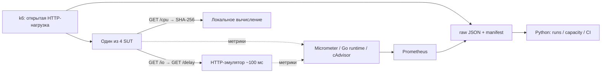

# Практическая работа № 3. Критерии научности исследования и проектирование экспериментального стенда

**Тема ВКР:** «Сравнительный анализ моделей конкурентности для REST-сервиса: нативные Java-потоки, виртуальные Java-потоки, Kotlin coroutines, goroutines».  
**Репозиторий работы:** https://github.com/gnchr/pr3-research

## 1. Тема ВКР и постановка задачи

Веб-сервисы обслуживают много конкурентных запросов, причём разные виды работы предъявляют неодинаковые требования к ресурсам. При I/O-bound задаче обработчик преимущественно ожидает внешнюю систему; при CPU-bound задаче занят вычислением. Нативные платформенные потоки Java, виртуальные потоки Java, Kotlin coroutines и goroutines по-разному организуют конкурентное исполнение. Однако сама модель конкурентности не сокращает длительность внешнего HTTP-ответа; потенциальное преимущество должно проявляться под нагрузкой при сохранении качества обслуживания.

**Цель ВКР** — сопоставить производительность и потребление ресурсов функционально эквивалентных REST-сервисов с четырьмя моделями исполнения. **Задача данной ПР3** — на основе научной литературы сформулировать измеримые критерии, проверяемые гипотезы, протокол воспроизведения и проект экспериментального стенда.

Предмет исследования — влияние выбора модели обработки конкурентных запросов на пропускную способность, задержки и ресурсы; объект — REST-сервис с двумя сценариями. **Важно:** текущая практическая работа завершена как проект: четыре исполняемые реализации и подтверждающая серия измерений не созданы. Сведения ниже — планы и проектные величины, не экспериментально установленные эффекты.

## 2. Подборка и анализ научных публикаций

### 2.1. Обоснование подборки

Изучены **семь** работ 2023–2026 гг.; все имеют экспериментальную часть, а требуемая квота рецензируемых публикаций выполняется. Открытые пакеты кода/данных подтверждены для A5 и A6. Следовательно, требования задания о **не менее 6 статьях, 4 экспериментальных, 3 свежих и 2 рецензируемых** выполнены.

| ID | Источник и предмет | Наличие открытого артефакта | Воспроизводимость |
|---|---|---|---:|
| A1 | Likuś, Krużel (2025): platform/virtual threads в Spring | Не подтверждён | 1/3 |
| A2 | Grabowiec, Wiktor, Smołka (2024): Kotlin coroutines и I/O | Не подтверждён | 1/3 |
| A3 | Rosà и др. (2023): экспериментальная JVM и Jetty | Не подтверждён | 1/3 |
| A4 | Šimatović и др. (2025): виртуальные потоки, CPU/GC | Не подтверждён | 1/3 |
| A5 | Soares, Terra (2024): Go/Java и REST/gRPC | [GitHub](https://github.com/PqES/2024_sblp) | 2/3 |
| A6 | Di Meglio, Starace (2024): REST-фреймворки | [Zenodo v2](https://zenodo.org/records/13495203) | 3/3 |
| A7 | Sari, David (2026): модели конкурентности Go/I/O | Не подтверждён | 1/3 |

**Шкала воспроизводимости:** 0 — недостаточно описания; 1 — есть методика, артефакт не найден; 2 — код/данные опубликованы, окружение закреплено неполно; 3 — опубликован пакет с окружением и сценарием. Баллы означают оценку доступных свидетельств, а не факт нашего независимого запуска.

### 2.2. Что исследовали авторы

A1 — наиболее близкий Java/Spring-контраст, однако исследует эмулированное ожидание внутри сервиса вместо отдельного upstream HTTP и имеет лишь два прогона. A2 рассматривает Kotlin и I/O, но виртуальные потоки в одном REST-тесте не оценены из-за ограничений клиента. A3 использует модифицированную JVM и Jetty: вывод не равнозначен измерениям стабильного Spring Boot. A4 подтверждает важность CPU/heap/GC, но не является симметричным REST-тестом. A5 показывает смешение факторов «язык/HTTP-стек/модель». A6 даёт наиболее полноценный пример опубликованного replication package. A7 помогает проектировать контроль backpressure и внешней I/O-зависимости, однако использует PostgreSQL.

В таблице отражены ключевые результаты сравнения научных методик. **Полный анализ каждой из семи публикаций по всем 12 обязательным полям** — библиографическая ссылка, исследовательский вопрос, объект, независимые и зависимые переменные, контролируемые условия, стенд, методика, статистика, угрозы, артефакты и оценка воспроизводимости — доступен в [машиночитаемой сводной таблице articles_analysis.csv](https://github.com/gnchr/pr3-research/blob/main/PR3_artifacts/stage_02/articles_analysis.csv). Там, где сведения отсутствуют в статье, указано «не указано», а не предположение.

## 3. Синтез: практика экспериментов в предметной области

### 3.1. Принятые измерения и способы их получения

Наиболее распространены показатели RPS/throughput, средняя и хвостовая задержка (p95/p99), доля ошибок, CPU и память. Для открытой модели генерации запросов принципиально **не смешивать заданную нагрузку, реально начатую и успешно обработанную**: отдельно фиксируются `target_arrival_rps`, `actual_started_rps`, `successful_rps`, `dropped_iterations`. Хвостовую задержку следует рассчитывать только после точного определения успеха (HTTP 200 плюс верный JSON), одновременно учитывая ошибки и тайм-ауты. Иначе отбор только успешно завершённых быстрых ответов искусственно улучшит p95.

CPU (CPU-секунд/секунду), RSS контейнера (MiB), p50/p95/p99 и диагностические JVM/Go runtime метрики описывают цену обслуживания. JVM heap не следует напрямую сравнивать с Go heap как общий показатель всей памяти — для межплатформенного сравнения используют RSS и CPU.

### 3.2. Типовые ошибки работ

Обзор показывает пять особенно значимых рисков: слишком мало независимых повторов и отсутствие доверительных интервалов (A1), различный стек и пул соединений (A2, A5), насыщение генератора или эмулятора вместо SUT (A1, A7), неполно контролируемый JIT/GC/прогрев и порядок запусков (A1, A3, A4), неполная публикация данных и конфигурации (в противоположность A5/A6). Сравнение отдельных HTTP-запросов как независимых экспериментальных повторов было бы **псевдорепликацией**: статистическая единица — полноценный независимый запуск.

### 3.3. Вывод для собственного дизайна

A5 обосновывает факторное разделение и осторожность в Go/Java выводах; A6 — публикацию Docker/сценариев/raw/аналитики. В нашем дизайне добавлены общий HTTP-контракт, одинаковый Java-бинарник для основной пары, независимые повторы, рандомизированный порядок, контроль двух внешних компонентов и заранее объявленный критерий устойчивости. Ни один из семи источников **не устанавливает универсальный норматив** p95 200 мс, 1% ошибок или 15% выигрыша; они выбраны как проектные критерии нашего учебного опыта.

## 4. Критерии научности, RQ, гипотезы и переменные

### 4.1. Исследовательские вопросы

**RQ1 (основной):** обеспечивает ли виртуальный Java-поток более высокую максимальную **подтверждённую устойчивую пропускную способность** (`C`) того же Spring REST-сервиса на I/O при одинаковых критериях p95 и ошибок, чем платформенный поток?

**RQ2:** как различаются Kotlin coroutines и Java-модели по RPS, p95, ошибкам и ресурсам на общих L1–L3? **RQ3:** как ведёт себя Go/net/http по тем же показателям относительно JVM? **RQ4:** как изменяются сравнительные показатели на CPU-bound вместо I/O-bound? На вторичных сравнениях **максимум ёмкости не измеряется по дизайну**, запрещены выводы о максимальном RPS Kotlin/Go/CPU.

### 4.2. Основная гипотеза

Пусть `C_PT` и `C_VT` — максимальный **подтверждённый в испытанной сетке** успешный RPS платформенного и виртуального Java-варианта соответственно при соблюдении ограничений качества. Определим `ρ = C_VT/C_PT` при `C_PT > 0`. Практически существенным выбран выигрыш **свыше 15%**.

- **H₀:** `ρ ≤ 1.15` — практически существенное преимущество виртуальных потоков не показано.
- **H₁:** `ρ > 1.15` — виртуальные потоки имеют практически существенное преимущество.

Для подтверждения H₁ обе границы ёмкости должны быть установлены, а односторонняя **нижняя 95%-я доверительная граница** для `ρ` должна превосходить 1.15 с учётом дискретного шага. Иначе H₁ не подтверждается; отсутствие значимости **не доказывает H₀**. При незамкнутой границе или нестабильном интервале результат неопределённый.

### 4.3. Факторы и метрики

| Тип | Переменная | Уровни / измерение |
|---|---|---|
| Независимая | Модель | J-PT, J-VT, K-CO, G-GO |
| Независимая | Характер задачи | `GET /io` с `GET /delay`; `GET /cpu` с SHA-256 |
| Независимая | Нагрузка | L1, L2, L3; общие по четырём моделям в рамках каждого сценария |
| Основная зависимая | Ёмкость `C` | Только две Java/I/O реализации; maximum confirmed successful RPS в испытанной сетке |
| Зависимая | `p95_success`, мс | Клиентские k6 HTTP-фазы `sending + waiting + receiving` по семантически корректным HTTP 200; **без DNS, TCP setup** |
| Зависимая | Ошибки, % | Неуспешные/все начатые запросы, включая тайм-ауты и неверный JSON |
| Зависимая | `successful_rps` | Правильно обработанные запросы, начатые в измерительном окне / 180 с |
| Дополнительные | CPU, RSS, p50/p99, GC и runtime | CPU-секунд/сек., MiB, мс, события |

**Контролируемые условия:** одинаковый Java-артефакт J-PT/J-VT, JDK/Boot/клиент, конфигурация SUT, HTTP/1.1, keep-alive, тайм-ауты, лимиты CPU/RAM, фиксированные данные и N для CPU, время ожидания эмулятора, режим k6 и отсутствие других активных SUT. Go — полный межплатформенный стек, а не изолированный эффект goroutines.

### 4.4. Критерии научности и выполнение

| Критерий | Способ соблюдения |
|---|---|
| Объективность / измеримость | Определения p95, RPS, ошибок; raw-записи запросов, таймстемпы и единицы |
| Контроль переменных | Один Java-бинарник и фиксированные ресурсы; мониторинг k6/эмулятора |
| Повторяемость | 10 независимых измерений/условие, seed, блочная рандомизация и оценка разброса |
| Воспроизводимость | Git SHA, lockfiles, OCI digest, одна команда `make reproduce`, raw и обработка |
| Реплицируемость | Описан API/алгоритм для независимой реализации и сравнения закономерностей |
| Внутренняя валидность | Реальный `Thread.isVirtual()`, настоящий `suspend`, исправность внешнего тракта |
| Конструктная валидность | `C` не приравнивается к RPS одной случайной точки; p95 только корректных ответов вместе с учётом ошибок |
| Статистическая валидность | Независимый `run_id`, блочный bootstrap, интервалы и неопределённый исход |
| Внешняя валидность | Явные ограничения среды, стека, HTTP/1.1 и лабораторных задач |
| Фальсифицируемость | Порог `ρ`, критерий неподтверждения и требование обнаружить обе границы |

**Утверждённые проектные ориентиры, а не SLA:** `p95_success ≤ 200 мс`; ошибки `≤ 1%`; practically significant `ρ > 1.15`; отклонение фактической подачи RPS `≤ 1%`; стабильная ступень — **не менее 9 из 10** технически валидных повторов. Задержка 200 мс выбранa относительно номинальных 100 мс эмулятора, 1% — исследовательский допуск отказов, 15% — заранее выбранный практический эффект. Эти величины **не выведены напрямую из A1–A7**. До основных испытаний технический пилот должен проверить пригодность значений; любые изменения требуют отдельного согласования **до** получения подтверждающих данных.

## 5. Обеспечение проверяемости и сценарий проверки

### 5.1. Десять уровней фиксации

| Что фиксируем | Чем и как проверяем |
|---|---|
| Код | Git SHA и tag релиза, одинаковая Java-сборка |
| Зависимости | Gradle wrapper/lockfile, `go.mod/go.sum`, Python `uv.lock` |
| Окружение | OCI SHA digest, Compose, JVM/Go flags, host manifest, cgroup |
| Данные | 32 нулевых байта в `cpu_input.bin`, эталон SHA-256 и SHA256SUMS |
| Конфигурация | `experiment.yaml`, `acceptance.yaml`, ресурсы, timeout, pool |
| Случайность | Seed и сохранённый порядок блоков |
| Запуск | Корневой README, единая команда `make reproduce` |
| Метаданные | `results/manifests/<run_id>.json` с хешами/окнами/валидностью |
| Сырые результаты | `results/raw`, `runs.csv`, `capacity_estimates.csv`, `comparisons.csv` |
| Независимая проверка | CI smoke для функциональности и полный benchmark на выделенном хосте |

### 5.2. Действия независимого разработчика

После получения **будущего релиза исполняемого стенда**, установки системных инструментов Git, Docker Engine/Compose и make на Linux x86_64 проверяющий запускает из корневого каталога одну команду:

```bash
make reproduce
```

Она проектно выполняет preflight, сборку/загрузку закреплённых образов, поднятие сетевых компонентов, проверку API, последовательный прогрев/измерения, сбор сырья и манифестов, контроль SHA и расчёт статистики. Возникают `PASS`, `FAIL` или `UNVERIFIED` с причинами. CI smoke **не доказывает H₁**. Файловые checksum и смысл ответов API требуют точного совпадения, производительность оценивается статистически: допуск `Δ_m` определяется A/A пилотом на данном хосте до независимого теста, не подменяется выдуманным процентом.

**Статус реализации:** `pr3-benchmark` и `make reproduce` ещё не реализованы; OCI digests, N и реальные результаты неизвестны. В документационном репозитории уже находятся проверяющий `verify_contract.py` и fixture, которым нужен реально запущенный SUT. Нынешний репозиторий `pr3-research` — хранилище проекта, **не исполняемый benchmark**.


**Последовательность проверки после публикации исполняемого релиза:** (1) получить release tag и сверить commit SHA; (2) выполнить preflight хоста, Docker и конфигурации квот; (3) проверить SHA-256 входного файла и эталон CPU; (4) запустить `make reproduce`; (5) дождаться контрактного тестирования, прогрева и измерений; (6) независимо пересчитать статистику из сохранённого сырья. CI smoke проверяет только функции и не подтверждает научную гипотезу.

**Ожидаемый выход:** `runs.csv` (по одной строке на независимый прогон), `capacity_estimates.csv` (ёмкость только J-PT/io и J-VT/io; у остальных `not_estimated_by_design`), `comparisons.csv` (отношение ёмкости, доверительные границы и статус), неизменяемые `results/raw/` и JSON-манифесты. Для SHA-256 и ответов HTTP требуется **точное совпадение**, для достигнутой интенсивности допустимо **≤1%** отклонения от заданной, а допустимый статистический разброс между независимыми запусками `Δ_m` определяется будущим A/A-пилотом перед измерительной серией. При несоблюдении технических условий вывод `UNVERIFIED`, а не искусственное подтверждение H₁.

## 6. Проект экспериментального стенда

### 6.1. Архитектура

В системе пять типов компонентов: SUT, нагрузка k6, измерения и мониторинг, сырые данные, анализ. Четыре SUT активируются **поочерёдно**. `GET /io` делает запрос к отдельному HTTP-эмулятору `GET /delay`, `GET /cpu` вычисляет фиксированную SHA-256 цепочку локально.



Полная компонентная диаграмма опубликована как [редактируемый исходный код Mermaid](https://github.com/gnchr/pr3-research/blob/main/PR3_artifacts/stage_05/stand_architecture.mmd).

**I/O-контракт:** `GET /io` реально обращается к `GET /delay` (номинально 100 мс) и выдаёт HTTP 200, `{"scenario":"io","payload":"OK"}`, только при успехе upstream. **CPU-контракт:** `state = 32 нулевых байта`; N раз `state = SHA-256(state)` по **бинарным**, а не hex-байтам; ответ `{"scenario":"cpu","digest":"<hex>","iterations":N}`. Один N для всех моделей определяется будущим пилотом и проверяется независимым digest и профилем CPU.

### 6.2. Спецификация компонентов

Ниже указаны **проектные версии, роли, планируемые образы и научное обоснование**. Это не фактически проверенные контейнерные digest; при реализации версии, lockfiles, теги и хеши фиксируются до запуска основной серии.

| Компонент и роль | Технология и версия | Предполагаемый образ | Обоснование |
|---|---|---|---|
| J-PT/J-VT — основная пара REST SUT | Temurin **21.0.12+8**, Spring Boot **3.5.16**, MVC/Tomcat, общий Java-бинарник | `pr3/sut-java:<git-sha>` | [A1, A3]: сравнение типа потоков без смены Java-бизнес-логики; виртуальность подтверждается `Thread.isVirtual()` |
| K-CO — альтернативный JVM SUT | JDK 21, Kotlin **2.2.20**, coroutines **1.11.0**, MVC `suspend` и WebClient `awaitBody` | `pr3/sut-kotlin:<git-sha>` | [A2]: контроль неблокирующего I/O без скрытого `.block()` |
| G-GO — межплатформенный REST SUT | Go **1.27.4**, `net/http`, goroutines | `pr3/sut-go:<git-sha>` | [A5, A7]: сравнение полного Go REST-стека, не изолированной стоимости goroutines |
| HTTP-эмулятор — управляемая I/O-зависимость | Go **1.27.4**, `GET /delay`, `/health`, `/metrics` | `pr3/io-emulator:<git-sha>` | В отличие от `Thread.sleep` в [A1], проверяет внешний HTTP и его возможное насыщение |
| Генератор k6 — открытая нагрузка | Grafana k6 **1.8.2**; `constant-arrival-rate` | `grafana/k6:<digest>` | Подача независимо от времени ответа; отдельный контроль `dropped_iterations` |
| Сбор метрик — мониторинг | cAdvisor **0.60.6**, Prometheus **3.15.0**, Micrometer | Образы с закреплёнными digest | [A4, A6]: раздельные CPU/RSS и JVM/Go-runtime метрики |
| Анализ и управление | Python **3.13.17**, Docker Engine **28.0.4**, Compose **2.35.1** | `pr3/analysis:<git-sha>` | [A5, A6]: raw, скрипты статистики и одна команда для воспроизведения |

### 6.3. Спецификация окружения

Проектный выделенный хост — **Linux x86_64/amd64 с cgroup v2**, не менее **16 логических CPU и 32 GiB RAM**. Эти требования не следует представлять как характеристики уже использованной машины. При будущем запуске фиксируются версия ядра, NUMA/SMT, частота и governor CPU, cgroup и фоновые процессы.

| Компонент | Лимит CPU | Лимит RAM | Сетевые и ресурсные условия |
|---|---:|---:|---|
| Один активный SUT | 4 CPU | 4 GiB | Фиксированные квоты, для JVM heap около 2 GiB; остальные SUT не запускаются |
| Генератор k6 | 4 CPU | 4 GiB | Не допускается насыщение CPU/VU; dropped итерации контролируются отдельно |
| HTTP-эмулятор | 4 CPU | 4 GiB | Обязательный запас по мощности на I/O-нагрузке |
| cAdvisor/Prometheus и оркестратор | Остаток выделенной машины | Остаток | Мониторинг не должен искажать результаты |

Сеть организуется в изолированном сегменте Docker Compose, без внешнего интернет-маршрута измерений. Для SUT заданы **HTTP/1.1, keep-alive, одинаковые тайм-ауты, connection pool и JSON-контракт**. Настройки `cpus`, `mem_limit`, `cpuset`, топология процессора и изоляция генератора подтверждаются технической калибровкой до основной серии.
### 6.4. План измерений

| Серия | Конфигурации | Повторы | Всего |
|---|---|---:|---:|
| Базовая | 4 модели × 2 сценария × 3 фиксированных L1/L2/L3 | 10 | **240** |
| Поиск границы | Только J-PT/io и J-VT/io; по 4–8 новых ступеней | 10 | **+80–160** |
| **Итого без пилота/A/A** | | | **320–400** |

Три фиксированные нагрузки внутри каждого сценария одинаковы для всех моделей; их абсолютные значения определяет будущий технический пилот относительно J-PT. Проектное правило L1/L2/L3 — 20%/60%/100% от эталонной нагрузки. Только у двух Java/I/O вариантов дополнительная сетка с шагом ≤5% охватывает последнюю **успешную** и первую **непрошедшую** ступени. Нельзя назвать L3 максимальной ёмкостью Kotlin/Go/CPU.

Один независимый прогон: restart SUT → readiness → **60 с прогрева без измерений** → **180 с** `constant-arrival-rate` → дождаться завершений/тайм-аутов, собрать raw/метрики/манифесты → остановить SUT. Проектно **10 повторов** каждого условия в десяти случайно переставленных блоках, seed записывается заранее. Запросы учитываются по **времени начала** внутри измерительного окна. Если SUT ошибается/замедляется, это технически валидный **отрицательный результат качества**; если сломан генератор/эмулятор/логирование, это `technical_validity=invalid` с сохранением raw и повтором под другим `run_id`.

### 6.5. A/A, статистика и независимая проверка стенда

Перед подтверждающей серией: **P0** функциональные контракты/реальность потоков; **P1** калибровка внешнего тракта, k6, N, L1–L3, прогрева и A/A; **P2** фиксация seed/окон/порогов в `experiment.yaml` и `acceptance.yaml`; **M** измерения; **D** отдельные профилировочные диагностики; **R** независимый `make reproduce`. Пилотные данные не включаются в статистику H₁.

Для A/A — две скрыто обозначенные серии **одного и того же J-PT**, ориентировочно 10 независимых пар, чтобы оценить естественный шум p95/RPS и определить переносимые на данный хост `Δ_m`. Контроль k6/эмулятора должен подтвердить запас по мощности, а не просто отсутствие HTTP 5xx. Устойчивость ступени — **≥9 из 10 технически валидных повторов**. Для отношения `C_VT/C_PT` планируется **парный блочный bootstrap с 10 000 выборками**, односторонняя нижняя 95%-я граница и проверка консервативной границы, учитывающей шаг RPS. Неустановленные границы, недостаточные блоки или нестабильность интервала дают `undetermined`, а не ложное подтверждение гипотезы.

### 6.6. Угрозы валидности

| Угроза | Последствие | Мера |
|---|---|---|
| Разная логика Java-кода | Ложный «эффект потоков» | Одна Java-сборка, `Thread.isVirtual()`, одинаковые ответы |
| Блокирующие Kotlin coroutine | Нечестное сравнение | Реальный `suspend`, без `.block()`/ `runBlocking` в I/O |
| Насыщение k6/эмулятора | Мнимый предел SUT | Отдельный нагрузочный пилот, CPU/VU/in-flight/drops |
| JIT/GC/температурный дрейф | Смещение результатов порядком | Прогрев, рандомизированные блоки и метрики |
| Ошибочный p95 успешных | Survivorship bias | Вместе с p95 проверять все ошибки и полноту окон |
| Псевдорепликация | Необоснованная значимость | Статистическая единица — полный запуск, не HTTP-запрос |
| Крупный шаг RPS | Некорректный вывод о C | Пилотная сетка, шаг ≤5%, статус неопределённости |
| Go/JVM смешения | Ложный «эффект goroutines» | Ограничивать сравнение полным Go REST-стеком |
| Подгонка критериев | Независимый эксперимент превращается в подтверждение ожиданий | Изменения только после пилота и **до M**, с отдельным согласованием |

Для всех выявленных **32 угроз валидности** определены контролирующие меры; в таблице перечислены ключевые угрозы, влияющие на интерпретацию основных результатов.

### 6.7. Структура будущего репозитория исполняемого стенда

```text
pr3-benchmark/                   # будущий, не реализованный стенд
  README.md                     # предустановки, быстрый старт, одна команда
  Makefile                      # make reproduce, make up/down, smoke
  apps/{java,kotlin,go}/        # четыре режима исполнения трёх приложений
  io-emulator/                  # /delay и метрики
  load/k6/                      # профили нагрузки
  configs/{experiment,acceptance,sut}.yaml
  fixtures/{cpu_input.bin,SHA256SUMS}
  analysis/                     # validate, aggregate, bootstrap, plot
  results/{raw,manifests,processed}/
  docs/                         # спецификация и протокол воспроизведения
```

### 6.8. Итог проектирования и границы выводов

Получен проект эксперимента для четырёх функционально сопоставимых REST-реализаций с двумя типами задач и открытой нагрузкой. Научная гипотеза проверяет выигрыш **Java virtual threads** перед platform threads по максимальной подтверждённой устойчивой пропускной способности при ограничениях p95/ошибок. Для Kotlin, Go и CPU сравнение остаётся описательным на трёх фиксированных нагрузках. Основная серия и пилот ещё **не выполнялись**: абсолютные значения RPS, `N` SHA-256, A/A-допуски, фактические OCI digest и результат проверки H₁ не известны и не придуманы.

## 7. Список литературы

1. [A1] Likuś P., Krużel F. *Analysis of Virtual Threads in Spring Applications*. ECMS, 2025. DOI: [10.7148/2025-0555](https://doi.org/10.7148/2025-0555).
2. [A2] Grabowiec M., Wiktor S., Smołka J. *Performance analysis of coroutines and other concurrency techniques in Kotlin language for I/O operations*. JCSI, 2024. DOI: [10.35784/jcsi.6353](https://doi.org/10.35784/jcsi.6353).
3. [A3] Rosà A. et al. *Automated Runtime Transition between Virtual and Platform Threads in the Java Virtual Machine*. IEEE APSEC, 2023. DOI: [10.1109/APSEC60848.2023.00080](https://doi.org/10.1109/APSEC60848.2023.00080).
4. [A4] Šimatović M. et al. *Evaluating Memory Management and Garbage Collection Algorithms with Virtual Threads in High-Concurrency Java Applications*. IEEE MIPRO, 2025. DOI: [10.1109/MIPRO65660.2025.11131846](https://doi.org/10.1109/MIPRO65660.2025.11131846).
5. [A5] Soares L. O., Terra R. *Go x Java e gRPC x REST: Um estudo empírico*. SBLP, 2024. DOI: [10.5753/SBLP.2024.3686](https://doi.org/10.5753/SBLP.2024.3686). [Артефакт](https://github.com/PqES/2024_sblp).
6. [A6] Di Meglio S., Starace L. L. L. *Evaluating Performance and Resource Consumption of REST Frameworks and Execution Environments*. IEEE Access, 2024. DOI: [10.1109/ACCESS.2024.3489892](https://doi.org/10.1109/ACCESS.2024.3489892). [Zenodo](https://zenodo.org/records/13495203).
7. [A7] Sari S. Y., David F. *Performance and Stability Evaluation of Concurrency Models for I/O-Bound Services in Golang under High-Volume Transaction Load*. IJSECS, 2026. DOI: [10.35870/ijsecs.v6i2.7490](https://doi.org/10.35870/ijsecs.v6i2.7490).

Дополнительные основания: [ACM Artifact Review and Badging](https://www.acm.org/publications/policies/artifact-review-and-badging-current), документация [Grafana k6](https://grafana.com/docs/k6/latest/using-k6/scenarios/executors/constant-arrival-rate/), [Gradle locks](https://docs.gradle.org/current/userguide/dependency_locking.html) и [Go modules](https://go.dev/ref/mod).

---
