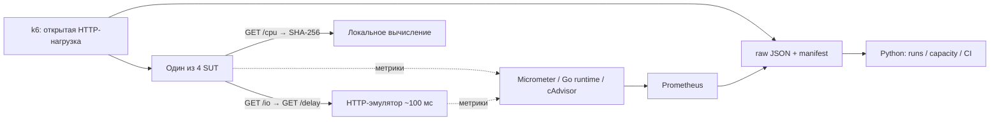

# Практическая работа № 3. Критерии научности исследования и проектирование экспериментального стенда

**Тема ВКР:** «Сравнительный анализ моделей конкурентности для REST-сервиса: нативные Java-потоки, виртуальные Java-потоки, Kotlin coroutines, goroutines».  
**Статус:** итоговый отчёт по проектированию исследования и экспериментального стенда; реальные нагрузочные испытания не проводились.  
**Основание:** утверждённые этапы 1–6, редакции по состоянию на 17.11.2026.  
**Репозиторий:** https://github.com/gnchr/pr3-research

## Содержание

1. Тема ВКР и постановка задачи.
2. Подборка статей и сводная таблица анализа.
3. Синтез практик экспериментальных исследований.
4. Критерии научности, исследовательские вопросы, гипотезы, переменные.
5. Обеспечение проверяемости и сценарий независимой проверки.
6. Проект экспериментального стенда, план измерений и угрозы валидности.
7. Список литературы.
8. Приложение А — полные карточки научных публикаций.

---

## 1. Тема ВКР и постановка задачи

Веб-сервисы обслуживают много конкурентных запросов, причём разные виды работы предъявляют неодинаковые требования к ресурсам. При I/O-bound задаче обработчик преимущественно ожидает внешнюю систему; при CPU-bound задаче занят вычислением. Нативные платформенные потоки Java, виртуальные потоки Java, Kotlin coroutines и goroutines по-разному организуют конкурентное исполнение. Однако сама модель конкурентности не сокращает длительность внешнего HTTP-ответа; потенциальное преимущество должно проявляться под нагрузкой при сохранении качества обслуживания.

**Цель ВКР** — сопоставить производительность и потребление ресурсов функционально эквивалентных REST-сервисов с четырьмя моделями исполнения. **Задача данной ПР3** — на основе научной литературы сформулировать измеримые критерии, проверяемые гипотезы, протокол воспроизведения и проект экспериментального стенда.

Предмет исследования — влияние выбора модели обработки конкурентных запросов на пропускную способность, задержки и ресурсы; объект — REST-сервис с двумя сценариями. **Важно:** текущая практическая работа завершена как проект: четыре исполняемые реализации и подтверждающая серия измерений не созданы. Сведения ниже — планы и проектные величины, не экспериментально установленные эффекты.

## 2. Подборка и анализ научных публикаций

### 2.1. Обоснование подборки

Изучены **семь** работ 2023–2026 гг.; все имеют экспериментальную часть, а требуемая квота рецензируемых публикаций выполняется. Открытые пакеты кода/данных подтверждены для A5 и A6. Следовательно, требования задания о **не менее 6 статьях, 4 экспериментальных, 3 свежих и 2 рецензируемых** выполнены.

| ID | Источник и предмет | Наличие открытого артефакта | Воспроизводимость |
|---|---|---|---:|
| A1 | Likuś, Krużel (2025): platform/virtual threads в Spring | Не подтверждён | 1/3 |
| A2 | Grabowiec, Wiktor, Smołka (2024): Kotlin coroutines и I/O | Не подтверждён | 1/3 |
| A3 | Rosà и др. (2023): экспериментальная JVM и Jetty | Не подтверждён | 1/3 |
| A4 | Šimatović и др. (2025): виртуальные потоки, CPU/GC | Не подтверждён | 1/3 |
| A5 | Soares, Terra (2024): Go/Java и REST/gRPC | [GitHub](https://github.com/PqES/2024_sblp) | 2/3 |
| A6 | Di Meglio, Starace (2024): REST-фреймворки | [Zenodo v2](https://zenodo.org/records/13495203) | 3/3 |
| A7 | Sari, David (2026): модели конкурентности Go/I/O | Не подтверждён | 1/3 |

**Шкала воспроизводимости:** 0 — недостаточно описания; 1 — есть методика, артефакт не найден; 2 — код/данные опубликованы, окружение закреплено неполно; 3 — опубликован пакет с окружением и сценарием. Баллы означают оценку доступных свидетельств, а не факт нашего независимого запуска.

### 2.2. Что исследовали авторы

A1 — наиболее близкий Java/Spring-контраст, однако исследует эмулированное ожидание внутри сервиса вместо отдельного upstream HTTP и имеет лишь два прогона. A2 рассматривает Kotlin и I/O, но виртуальные потоки в одном REST-тесте не оценены из-за ограничений клиента. A3 использует модифицированную JVM и Jetty: вывод не равнозначен измерениям стабильного Spring Boot. A4 подтверждает важность CPU/heap/GC, но не является симметричным REST-тестом. A5 показывает смешение факторов «язык/HTTP-стек/модель». A6 даёт наиболее полноценный пример опубликованного replication package. A7 помогает проектировать контроль backpressure и внешней I/O-зависимости, однако использует PostgreSQL.

Полные сведения **по 12 обязательным полям для каждой из семи статей** приведены в приложении А, а машиночитаемая сводная таблица — в [articles_analysis.csv](PR3_artifacts/stage_02/articles_analysis.csv). В ячейках без подтверждённых сведений сохранено «не указано», что является результатом методологического анализа, а не пропуском.

## 3. Синтез: практика экспериментов в предметной области

### 3.1. Принятые измерения и способы их получения

Наиболее распространены показатели RPS/throughput, средняя и хвостовая задержка (p95/p99), доля ошибок, CPU и память. Для открытой модели генерации запросов принципиально **не смешивать заданную нагрузку, реально начатую и успешно обработанную**: отдельно фиксируются `target_arrival_rps`, `actual_started_rps`, `successful_rps`, `dropped_iterations`. Хвостовую задержку следует рассчитывать только после точного определения успеха (HTTP 200 плюс верный JSON), одновременно учитывая ошибки и тайм-ауты. Иначе отбор только успешно завершённых быстрых ответов искусственно улучшит p95.

CPU (CPU-секунд/секунду), RSS контейнера (MiB), p50/p95/p99 и диагностические JVM/Go runtime метрики описывают цену обслуживания. JVM heap не следует напрямую сравнивать с Go heap как общий показатель всей памяти — для межплатформенного сравнения используют RSS и CPU.

### 3.2. Типовые ошибки работ

Обзор показывает пять особенно значимых рисков: слишком мало независимых повторов и отсутствие доверительных интервалов (A1), различный стек и пул соединений (A2, A5), насыщение генератора или эмулятора вместо SUT (A1, A7), неполно контролируемый JIT/GC/прогрев и порядок запусков (A1, A3, A4), неполная публикация данных и конфигурации (в противоположность A5/A6). Сравнение отдельных HTTP-запросов как независимых экспериментальных повторов было бы **псевдорепликацией**: статистическая единица — полноценный независимый запуск.

### 3.3. Вывод для собственного дизайна

A5 обосновывает факторное разделение и осторожность в Go/Java выводах; A6 — публикацию Docker/сценариев/raw/аналитики. В нашем дизайне добавлены общий HTTP-контракт, одинаковый Java-бинарник для основной пары, независимые повторы, рандомизированный порядок, контроль двух внешних компонентов и заранее объявленный критерий устойчивости. Ни один из семи источников **не устанавливает универсальный норматив** p95 200 мс, 1% ошибок или 15% выигрыша; они выбраны как проектные критерии нашего учебного опыта.

## 4. Критерии научности, RQ, гипотезы и переменные

### 4.1. Исследовательские вопросы

**RQ1 (основной):** обеспечивает ли виртуальный Java-поток более высокую максимальную **подтверждённую устойчивую пропускную способность** (`C`) того же Spring REST-сервиса на I/O при одинаковых критериях p95 и ошибок, чем платформенный поток?

**RQ2:** как различаются Kotlin coroutines и Java-модели по RPS, p95, ошибкам и ресурсам на общих L1–L3? **RQ3:** как ведёт себя Go/net/http по тем же показателям относительно JVM? **RQ4:** как изменяются сравнительные показатели на CPU-bound вместо I/O-bound? На вторичных сравнениях **максимум ёмкости не измеряется по дизайну**, запрещены выводы о максимальном RPS Kotlin/Go/CPU.

### 4.2. Основная гипотеза

Пусть `C_PT` и `C_VT` — максимальный **подтверждённый в испытанной сетке** успешный RPS платформенного и виртуального Java-варианта соответственно при соблюдении ограничений качества. Определим `ρ = C_VT/C_PT` при `C_PT > 0`. Практически существенным выбран выигрыш **свыше 15%**.

- **H₀:** `ρ ≤ 1.15` — практически существенное преимущество виртуальных потоков не показано.
- **H₁:** `ρ > 1.15` — виртуальные потоки имеют практически существенное преимущество.

Для подтверждения H₁ обе границы ёмкости должны быть установлены, а односторонняя **нижняя 95%-я доверительная граница** для `ρ` должна превосходить 1.15 с учётом дискретного шага. Иначе H₁ не подтверждается; отсутствие значимости **не доказывает H₀**. При незамкнутой границе или нестабильном интервале результат неопределённый.

### 4.3. Факторы и метрики

| Тип | Переменная | Уровни / измерение |
|---|---|---|
| Независимая | Модель | J-PT, J-VT, K-CO, G-GO |
| Независимая | Характер задачи | `GET /io` с `GET /delay`; `GET /cpu` с SHA-256 |
| Независимая | Нагрузка | L1, L2, L3; общие по четырём моделям в рамках каждого сценария |
| Основная зависимая | Ёмкость `C` | Только две Java/I/O реализации; maximum confirmed successful RPS в испытанной сетке |
| Зависимая | `p95_success`, мс | Клиентские k6 HTTP-фазы `sending + waiting + receiving` по семантически корректным HTTP 200; **без DNS, TCP setup** |
| Зависимая | Ошибки, % | Неуспешные/все начатые запросы, включая тайм-ауты и неверный JSON |
| Зависимая | `successful_rps` | Правильно обработанные запросы, начатые в измерительном окне / 180 с |
| Дополнительные | CPU, RSS, p50/p99, GC и runtime | CPU-секунд/сек., MiB, мс, события |

**Контролируемые условия:** одинаковый Java-артефакт J-PT/J-VT, JDK/Boot/клиент, конфигурация SUT, HTTP/1.1, keep-alive, тайм-ауты, лимиты CPU/RAM, фиксированные данные и N для CPU, время ожидания эмулятора, режим k6 и отсутствие других активных SUT. Go — полный межплатформенный стек, а не изолированный эффект goroutines.

### 4.4. Критерии научности и выполнение

| Критерий | Способ соблюдения |
|---|---|
| Объективность / измеримость | Определения p95, RPS, ошибок; raw-записи запросов, таймстемпы и единицы |
| Контроль переменных | Один Java-бинарник и фиксированные ресурсы; мониторинг k6/эмулятора |
| Повторяемость | 10 независимых измерений/условие, seed, блочная рандомизация и оценка разброса |
| Воспроизводимость | Git SHA, lockfiles, OCI digest, одна команда `make reproduce`, raw и обработка |
| Реплицируемость | Описан API/алгоритм для независимой реализации и сравнения закономерностей |
| Внутренняя валидность | Реальный `Thread.isVirtual()`, настоящий `suspend`, исправность внешнего тракта |
| Конструктная валидность | `C` не приравнивается к RPS одной случайной точки; p95 только корректных ответов вместе с учётом ошибок |
| Статистическая валидность | Независимый `run_id`, блочный bootstrap, интервалы и неопределённый исход |
| Внешняя валидность | Явные ограничения среды, стека, HTTP/1.1 и лабораторных задач |
| Фальсифицируемость | Порог `ρ`, критерий неподтверждения и требование обнаружить обе границы |

**Утверждённые проектные ориентиры, а не SLA:** `p95_success ≤ 200 мс`; ошибки `≤ 1%`; practically significant `ρ > 1.15`; отклонение фактической подачи RPS `≤ 1%`; стабильная ступень — **не менее 9 из 10** технически валидных повторов. Задержка 200 мс выбранa относительно номинальных 100 мс эмулятора, 1% — исследовательский допуск отказов, 15% — заранее выбранный практический эффект. Эти величины **не выведены напрямую из A1–A7**. До основных испытаний технический пилот должен проверить пригодность значений; любые изменения требуют отдельного согласования **до** получения подтверждающих данных.

## 5. Обеспечение проверяемости и сценарий проверки

### 5.1. Десять уровней фиксации

| Что фиксируем | Чем и как проверяем |
|---|---|
| Код | Git SHA и tag релиза, одинаковая Java-сборка |
| Зависимости | Gradle wrapper/lockfile, `go.mod/go.sum`, Python `uv.lock` |
| Окружение | OCI SHA digest, Compose, JVM/Go flags, host manifest, cgroup |
| Данные | 32 нулевых байта в `cpu_input.bin`, эталон SHA-256 и SHA256SUMS |
| Конфигурация | `experiment.yaml`, `acceptance.yaml`, ресурсы, timeout, pool |
| Случайность | Seed и сохранённый порядок блоков |
| Запуск | Корневой README, единая команда `make reproduce` |
| Метаданные | `results/manifests/<run_id>.json` с хешами/окнами/валидностью |
| Сырые результаты | `results/raw`, `runs.csv`, `capacity_estimates.csv`, `comparisons.csv` |
| Независимая проверка | CI smoke для функциональности и полный benchmark на выделенном хосте |

### 5.2. Действия независимого разработчика

После получения **будущего релиза исполняемого стенда**, установки системных инструментов Git, Docker Engine/Compose и make на Linux x86_64 проверяющий запускает из корневого каталога одну команду:

```bash
make reproduce
```

Она проектно выполняет preflight, сборку/загрузку закреплённых образов, поднятие сетевых компонентов, проверку API, последовательный прогрев/измерения, сбор сырья и манифестов, контроль SHA и расчёт статистики. Возникают `PASS`, `FAIL` или `UNVERIFIED` с причинами. CI smoke **не доказывает H₁**. Файловые checksum и смысл ответов API требуют точного совпадения, производительность оценивается статистически: допуск `Δ_m` определяется A/A пилотом на данном хосте до независимого теста, не подменяется выдуманным процентом.

**Статус реализации:** `pr3-benchmark` и `make reproduce` ещё не реализованы; OCI digests, N и реальные результаты неизвестны. В документационном репозитории уже находятся проверяющий `verify_contract.py` и fixture, которым нужен реально запущенный SUT. Нынешний репозиторий `pr3-research` — хранилище проекта, **не исполняемый benchmark**.

## 6. Проект экспериментального стенда

### 6.1. Архитектура

В системе пять типов компонентов: SUT, нагрузка k6, измерения и мониторинг, сырые данные, анализ. Четыре SUT активируются **поочерёдно**. `GET /io` делает запрос к отдельному HTTP-эмулятору `GET /delay`, `GET /cpu` вычисляет фиксированную SHA-256 цепочку локально.



Полная компонентная диаграмма как код: [stand_architecture.mmd](PR3_artifacts/stage_05/stand_architecture.mmd).

**I/O-контракт:** `GET /io` реально обращается к `GET /delay` (номинально 100 мс) и выдаёт HTTP 200, `{"scenario":"io","payload":"OK"}`, только при успехе upstream. **CPU-контракт:** `state = 32 нулевых байта`; N раз `state = SHA-256(state)` по **бинарным**, а не hex-байтам; ответ `{"scenario":"cpu","digest":"<hex>","iterations":N}`. Один N для всех моделей определяется будущим пилотом и проверяется независимым digest и профилем CPU.

### 6.2. Компоненты и версии

| Компонент | Проектная технология / версия | Обоснование |
|---|---|---|
| J-PT/J-VT | Temurin 21.0.12+8, Spring Boot 3.5.16, Spring MVC/Tomcat, один Java binary | A1/A3, изолированное сопоставление потоков |
| K-CO | JVM 21, Kotlin 2.2.20, coroutines 1.11.0, Spring MVC `suspend`, WebClient `awaitBody` | A2; реальное неблокирующее ожидание |
| G-GO | Go 1.27.4, `net/http`, goroutines | A5/A7; межплатформенное сравнение |
| HTTP-эмулятор | Go 1.27.4, таймер `GET /delay`, метрики | Изоляция I/O; отличие от Thread.sleep A1 |
| Нагрузка | Grafana k6 1.8.2 | Открытая модель arrival rate и сырой JSON |
| Метрики | cAdvisor 0.60.6; Prometheus 3.15.0; Micrometer | CPU/RSS, JVM/Go диагностика, A4/A6 |
| Анализ/оркестрация | Python 3.13.17; Docker Engine 28.0.4, Compose 2.35.1 | Повторяемость, единая процедура |

Приведены **проектные версии**, а не проверенные релизные digest. При реализации версии/образы закрепляются и при невозможности получить указанный тег согласуются **до** измерений. Предполагаемый benchmark-хост — Linux amd64/cgroup v2, желательно не менее 16 логических CPU и 32 GiB RAM, независимые CPU/RAM квоты SUT, k6, HTTP-эмулятора и мониторинга. В проектном примере SUT, k6 и эмулятору выделяется по 4 CPU/4 GiB, оставшиеся ресурсы — мониторингу; схема CPU SMT/NUMA подлежит калибровке.

### 6.3. План измерений

| Серия | Конфигурации | Повторы | Всего |
|---|---|---:|---:|
| Базовая | 4 модели × 2 сценария × 3 фиксированных L1/L2/L3 | 10 | **240** |
| Поиск границы | Только J-PT/io и J-VT/io; по 4–8 новых ступеней | 10 | **+80–160** |
| **Итого без пилота/A/A** | | | **320–400** |

Три фиксированные нагрузки внутри каждого сценария одинаковы для всех моделей; их абсолютные значения определяет будущий технический пилот относительно J-PT. Проектное правило L1/L2/L3 — 20%/60%/100% от эталонной нагрузки. Только у двух Java/I/O вариантов дополнительная сетка с шагом ≤5% охватывает последнюю **успешную** и первую **непрошедшую** ступени. Нельзя назвать L3 максимальной ёмкостью Kotlin/Go/CPU.

Один независимый прогон: restart SUT → readiness → **60 с прогрева без измерений** → **180 с** `constant-arrival-rate` → дождаться завершений/тайм-аутов, собрать raw/метрики/манифесты → остановить SUT. Проектно **10 повторов** каждого условия в десяти случайно переставленных блоках, seed записывается заранее. Запросы учитываются по **времени начала** внутри измерительного окна. Если SUT ошибается/замедляется, это технически валидный **отрицательный результат качества**; если сломан генератор/эмулятор/логирование, это `technical_validity=invalid` с сохранением raw и повтором под другим `run_id`.

### 6.4. A/A, статистика и независимая проверка стенда

Перед подтверждающей серией: **P0** функциональные контракты/реальность потоков; **P1** калибровка внешнего тракта, k6, N, L1–L3, прогрева и A/A; **P2** фиксация seed/окон/порогов в `experiment.yaml` и `acceptance.yaml`; **M** измерения; **D** отдельные профилировочные диагностики; **R** независимый `make reproduce`. Пилотные данные не включаются в статистику H₁.

Для A/A — две скрыто обозначенные серии **одного и того же J-PT**, ориентировочно 10 независимых пар, чтобы оценить естественный шум p95/RPS и определить переносимые на данный хост `Δ_m`. Контроль k6/эмулятора должен подтвердить запас по мощности, а не просто отсутствие HTTP 5xx. Устойчивость ступени — **≥9 из 10 технически валидных повторов**. Для отношения `C_VT/C_PT` планируется **парный блочный bootstrap с 10 000 выборками**, односторонняя нижняя 95%-я граница и проверка консервативной границы, учитывающей шаг RPS. Неустановленные границы, недостаточные блоки или нестабильность интервала дают `undetermined`, а не ложное подтверждение гипотезы.

### 6.5. Угрозы валидности

| Угроза | Последствие | Мера |
|---|---|---|
| Разная логика Java-кода | Ложный «эффект потоков» | Одна Java-сборка, `Thread.isVirtual()`, одинаковые ответы |
| Блокирующие Kotlin coroutine | Нечестное сравнение | Реальный `suspend`, без `.block()`/ `runBlocking` в I/O |
| Насыщение k6/эмулятора | Мнимый предел SUT | Отдельный нагрузочный пилот, CPU/VU/in-flight/drops |
| JIT/GC/температурный дрейф | Смещение результатов порядком | Прогрев, рандомизированные блоки и метрики |
| Ошибочный p95 успешных | Survivorship bias | Вместе с p95 проверять все ошибки и полноту окон |
| Псевдорепликация | Необоснованная значимость | Статистическая единица — полный запуск, не HTTP-запрос |
| Крупный шаг RPS | Некорректный вывод о C | Пилотная сетка, шаг ≤5%, статус неопределённости |
| Go/JVM смешения | Ложный «эффект goroutines» | Ограничивать сравнение полным Go REST-стеком |
| Подгонка критериев | Независимый эксперимент превращается в подтверждение ожиданий | Изменения только после пилота и **до M**, с отдельным согласованием |

Полный принятый реестр — **32 угрозы**: [validity_threats.md](PR3_artifacts/stage_06/validity_threats.md).

### 6.6. Структура будущего репозитория исполняемого стенда

```text
pr3-benchmark/                   # будущий, не реализованный стенд
  README.md                     # предустановки, быстрый старт, одна команда
  Makefile                      # make reproduce, make up/down, smoke
  apps/{java,kotlin,go}/        # четыре режима исполнения трёх приложений
  io-emulator/                  # /delay и метрики
  load/k6/                      # профили нагрузки
  configs/{experiment,acceptance,sut}.yaml
  fixtures/{cpu_input.bin,SHA256SUMS}
  analysis/                     # validate, aggregate, bootstrap, plot
  results/{raw,manifests,processed}/
  docs/                         # спецификация и протокол воспроизведения
```

## 7. Список литературы

1. [A1] Likuś P., Krużel F. *Analysis of Virtual Threads in Spring Applications*. ECMS, 2025. DOI: [10.7148/2025-0555](https://doi.org/10.7148/2025-0555).
2. [A2] Grabowiec M., Wiktor S., Smołka J. *Performance analysis of coroutines and other concurrency techniques in Kotlin language for I/O operations*. JCSI, 2024. DOI: [10.35784/jcsi.6353](https://doi.org/10.35784/jcsi.6353).
3. [A3] Rosà A. et al. *Automated Runtime Transition between Virtual and Platform Threads in the Java Virtual Machine*. IEEE APSEC, 2023. DOI: [10.1109/APSEC60848.2023.00080](https://doi.org/10.1109/APSEC60848.2023.00080).
4. [A4] Šimatović M. et al. *Evaluating Memory Management and Garbage Collection Algorithms with Virtual Threads in High-Concurrency Java Applications*. IEEE MIPRO, 2025. DOI: [10.1109/MIPRO65660.2025.11131846](https://doi.org/10.1109/MIPRO65660.2025.11131846).
5. [A5] Soares L. O., Terra R. *Go x Java e gRPC x REST: Um estudo empírico*. SBLP, 2024. DOI: [10.5753/SBLP.2024.3686](https://doi.org/10.5753/SBLP.2024.3686). [Артефакт](https://github.com/PqES/2024_sblp).
6. [A6] Di Meglio S., Starace L. L. L. *Evaluating Performance and Resource Consumption of REST Frameworks and Execution Environments*. IEEE Access, 2024. DOI: [10.1109/ACCESS.2024.3489892](https://doi.org/10.1109/ACCESS.2024.3489892). [Zenodo](https://zenodo.org/records/13495203).
7. [A7] Sari S. Y., David F. *Performance and Stability Evaluation of Concurrency Models for I/O-Bound Services in Golang under High-Volume Transaction Load*. IJSECS, 2026. DOI: [10.35870/ijsecs.v6i2.7490](https://doi.org/10.35870/ijsecs.v6i2.7490).

Дополнительные основания: [ACM Artifact Review and Badging](https://www.acm.org/publications/policies/artifact-review-and-badging-current), документация [Grafana k6](https://grafana.com/docs/k6/latest/using-k6/scenarios/executors/constant-arrival-rate/), [Gradle locks](https://docs.gradle.org/current/userguide/dependency_locking.html) и [Go modules](https://go.dev/ref/mod).

---

## Приложение А. Методологический анализ публикаций A1–A7 по 12 обязательным полям

Ниже приведены полные принятые карточки научных публикаций из [этапа 2](PR3_artifacts/stage_02/stage_02_report.md). Формулировки «не указано» и «не подтверждено» сохранены. Эмпирические результаты **нашего** стенда в приложении отсутствуют.

### A1. Likuś P., Krużel F. Analysis of Virtual Threads in Spring Applications

**Библиографическая ссылка.** Likuś P., Krużel F. Analysis of Virtual Threads in Spring Applications // Proceedings of the 39th ECMS International Conference on Modelling and Simulation. 2025. P. 555–561. DOI: 10.7148/2025-0555. https://doi.org/10.7148/2025-0555

**Исследовательский вопрос / гипотеза.** Как виртуальные и платформенные потоки влияют на производительность Spring REST-приложения при изменении доли вычислений, ожидания и интенсивности HTTP-запросов? Формально заданные H₀/H₁: не указано.

**Объект исследования.** Spring Boot REST-сервис: обработчик выполняет CPU-работу bcrypt и управляемое ожидание; варианты обслуживания запросов платформенными или виртуальными потоками Java.

**Независимые переменные (факторы и уровни).** Тип потоков: platform/virtual; профиль нагрузки: 10, 20, 250, 400 запросов/с (при более высокой интенсивности наблюдались ограничения окружения); CPU-нагрузка: bcrypt cost 10 и cost 5; имитация I/O-ожидания Thread.sleep с множителями 0,5; 1; 1,5; 2; 3 относительно базовой задержки; рассматривались варианты JDK.

**Зависимые переменные (метрики и единицы).** Полная задержка HTTP-ответа (мс), включая среднее, p95, p99 и разброс; способность выдерживать заданный поток запросов, появление ошибок/сбоев при высокой интенсивности. Сопоставимые показатели ресурсоёмкости для всех режимов: не указано.

**Контролируемые условия.** Spring Boot 3.4.0; Java 21 (в т.ч. Amazon Corretto); MacBook с Apple M2 Pro, Docker/Colima, единая прикладная логика и тип нагрузки в парных вариантах; точные значения лимитов CPU/RAM контейнеров и полная конфигурация сети: не указано.

**Экспериментальный стенд.** Gatling (HTTP-нагрузка с задаваемой интенсивностью) → Spring Boot REST SUT, запущенный в Docker/Colima → локальное bcrypt-вычисление + Thread.sleep; сравнение при переключении типа потока.

**Методика (повторы, прогрев, длительность, порядок).** Один тест 3 минуты; по 2 прогона на тестируемое условие; прогрев JVM упомянут, его продолжительность и правило исключения из выборки не указаны; порядок запусков и рандомизация не указаны.

**Статистическая обработка.** Средние показатели, процентили p95/p99, стандартное отклонение; доверительные интервалы, статистические тесты значимости и поправки на множественные сравнения: не указано.

**Угрозы валидности (авторы; наш анализ).** По материалам авторов: при ~500 запросах/с проявлялась сетевая ошибка назначения адреса, ограничивающая наблюдаемый эффект; различия поведения зависят от CPU/I/O. Наш анализ: 2 повторения недостаточны для устойчивой оценки разброса; Thread.sleep не эквивалентен реальному исходящему HTTP-вызову; не подтверждён контроль ресурсов клиента/сети; нельзя обобщать на Go.

**Доступность артефактов (код, данные, окружение).** Открытая статья: https://www.scs-europe.net/dlib/2025/ecms2025acceptedpapers/0555_dis_ecms2025_0034.pdf ; отдельно опубликованные исходники/сырые данные/воспроизводимый контейнер: не подтверждены.

**Оценка воспроизводимости (0–3, обоснование).** 1 — описаны факторы, профиль Gatling и продолжительность, но проверенный код/данные отсутствуют; не хватает некоторых настроек окружения и прогрева.

**Проверенный первоисточник / раздел:** Likuś, Krużel (2025), раздел экспериментальной оценки и результаты, с. 555–561; DOI 10.7148/2025-0555.

### A2. Grabowiec M., Wiktor S., Smołka J. Performance analysis of coroutines and other concurrency techniques in Kotlin language for I/O operations

**Библиографическая ссылка.** Grabowiec M., Wiktor S., Smołka J. Performance analysis of coroutines and other concurrency techniques in Kotlin language for I/O operations // Journal of Computer Sciences Institute. 2024. Vol. 33. P. 306–312. DOI: 10.35784/jcsi.6353. https://doi.org/10.35784/jcsi.6353

**Исследовательский вопрос / гипотеза.** Как способы организации конкурентного выполнения в Kotlin/JVM влияют на время операций с файлами и обращений к REST API? Формальные H₀/H₁: не указано.

**Объект исследования.** Клиентские тестовые программы на Kotlin/JVM: запросы к вспомогательному REST API на .NET 6, возвращающему JSON, и локальные операции чтения/записи файла ~1 МБ; сравниваются способы запуска конкурентных задач.

**Независимые переменные (факторы и уровни).** Модель запуска: корутины Dispatchers.IO/Default, обычные потоки, пул платформенных потоков (число рабочих потоков соответствует ядрам CPU), виртуальные потоки; тип задачи: REST или файловый I/O; число операций/задач: 500, 1000, 2000, 5000. Важное исключение: в REST-части результаты виртуальных потоков не представлены из-за ограничений выбранного HttpClient.

**Зависимые переменные (метрики и единицы).** Среднее время выполнения операции/бенчмарка (мс, по JMH), потребление CPU (%), RAM (МБ); значения и графики для разных задач и размеров нагрузки.

**Контролируемые условия.** Windows 11 Pro 23H2, AMD Ryzen 5 5600X (6 ядер/12 потоков), 16 ГБ ОЗУ; JDK 22.0.1, Kotlin 2.0.0, kotlinx.coroutines 1.9.0-RC; тестовое REST API на .NET 6; единый тестовый объём файлов. Контроль независимых внешних сетевых задержек: не указано.

**Экспериментальный стенд.** JMH → Kotlin/JVM тестовые функции с thread/coroutine диспетчерами → тестовый REST API (.NET 6) или файловая система; VisualVM собирает CPU и RAM.

**Методика (повторы, прогрев, длительность, порядок).** JMH @Warmup(iterations=10,time=10 ms), @Measurement(iterations=10,time=10 ms), @Fork(1), @Threads(1). Внутри метода создаётся заданное количество конкурентных задач. Независимых запусков JVM: один fork; случайный порядок сравнения конфигураций не указан. 10 измерительных итераций JMH не равны 10 независимым прогонам.

**Статистическая обработка.** JMH выдаёт усреднённое время (мс/операцию); сравнения на графиках, CPU/RAM через VisualVM. Формальные критерии значимости, доверительные интервалы и поправка на множественные сравнения: не указано.

**Угрозы валидности (авторы; наш анализ).** Авторы: виртуальные потоки не протестированы в части REST из-за ограничений HTTP-клиента, поэтому группы неполные. Наш анализ: это преимущественно бенчмарк клиента, не серверного REST SUT; короткие 10-мс итерации и один fork не гарантируют репрезентативности; suspend/корутина не гарантирует неблокирующий I/O, если HTTP-клиент блокирует; иные серверные библиотеки/языки вносят смешение факторов.

**Доступность артефактов (код, данные, окружение).** Полный текст: https://ph.pollub.pl/index.php/jcsi/article/download/6353/4716/29594 ; подтверждённый публичный репозиторий, сырые замеры и pinned окружение: не обнаружены.

**Оценка воспроизводимости (0–3, обоснование).** 1 — версии ПО, JMH-аннотации и описания тестов доступны, но полный проверенный код/сырой датасет/запуск как артефакт не подтверждены; часть REST-сравнения отсутствует.

**Проверенный первоисточник / раздел:** Grabowiec et al. (2024), методика, конфигурация JMH, результаты REST и файловых тестов, с. 306–312; DOI 10.35784/jcsi.6353.

### A3. Rosà A., Basso M., Bohnhoff L., Binder W. Automated Runtime Transition between Virtual and Platform Threads in the Java Virtual Machine

**Библиографическая ссылка.** Rosà A., Basso M., Bohnhoff L., Binder W. Automated Runtime Transition between Virtual and Platform Threads in the Java Virtual Machine // 30th Asia-Pacific Software Engineering Conference (APSEC). IEEE, 2023. P. 607–611. DOI: 10.1109/APSEC60848.2023.00080. https://doi.org/10.1109/APSEC60848.2023.00080

**Исследовательский вопрос / гипотеза.** Может ли динамическое переключение между виртуальными и платформенными потоками повышать пропускную способность серверной обработки при сочетании CPU и блокирующих операций? Формальные H₀/H₁: не указано.

**Объект исследования.** Экспериментальная модификация JVM/JDK 20 с автоматическим переключением модели потока; HTTP-сервер Eclipse Jetty и синтетический запрос с контролируемыми вычислениями/блокировками.

**Независимые переменные (факторы и уровни).** Политика исполнения: только platform, только virtual, адаптивное переключение; максимум потоков пула Jetty: 16, 32, 48, 64, 80 (minimum=10); интенсивность: 1200–3600 запросов/с шагом 400; количество блокирующих операций: 0–8 (0,5 мс на блокировку); вычислительная часть ~5 мс; настройки алгоритма перехода.

**Зависимые переменные (метрики и единицы).** Пропускная способность: число успешно завершённых HTTP-запросов в 60-секундном измерительном окне (запросов/60 с, пересчитываемое в запросы/с); соотношение throughput с вариантами baseline; относительные потери/выигрыш. p95/p99 и распределение ошибок: не указано.

**Контролируемые условия.** Ubuntu 20.04.5, Intel Xeon E5-2680 2,7 ГГц, две NUMA-области по 8 ядер, 64 ГБ RAM; фиксированная версия модифицированной JDK 20 и сервер Jetty; генератор запускается отдельно на другой NUMA-области, режим производительности CPU; точный образ JVM/патч: не опубликован в проверенной форме.

**Экспериментальный стенд.** HTTP-генератор запросов → Jetty SUT с автоматическим выбором thread model на модифицированной JVM, машинная изоляция по NUMA; измеритель успешных запросов за окно.

**Методика (повторы, прогрев, длительность, порядок).** Пять независимых повторений условий; для каждой ступени после стабилизации входящего потока 60-секундный замер throughput; параметры перебираются по сетке. Полная продолжительность JVM warm-up, систематическая рандомизация порядка: не указано.

**Статистическая обработка.** Показаны средние по пяти испытаниям и разброс/относительное отклонение; формальные тесты значимости, тип и метод расчёта доверительных интервалов: не указано.

**Угрозы валидности (авторы; наш анализ).** Авторы обозначают исследование как предварительное (work in progress). Наш анализ: прототип нестандартной JVM может не переноситься на стабильные JDK 21+/Spring; короткие синтетические блокировки не равны реальному внешнему HTTP; настройки Jetty конкурируют с фактором thread model; исходники модификаций не подтверждены, а значит точное повторение ограничено.

**Доступность артефактов (код, данные, окружение).** Авторский PDF: https://www.dag.inf.usi.ch/wp-content/uploads/APSEC23-CR.pdf ; публичный пакет конкретной модифицированной JVM, исходников эксперимента и зафиксированного окружения не подтверждён. Упоминание доступного базового бенчмарка не означает доступность полного артефакта статьи.

**Оценка воспроизводимости (0–3, обоснование).** 1 — описание параметров и аппаратуры позволяет приблизительно воспроизвести постановку; точный артефакт модифицированной JVM и экспериментальные данные не подтверждены.

**Проверенный первоисточник / раздел:** Rosà et al. (2023), экспериментальная оценка Jetty, разделы Experiment/Evaluation, с. 607–611; DOI 10.1109/APSEC60848.2023.00080.

### A4. Šimatović M., Markulin H., Beronić D., Mihaljević B. Evaluating Memory Management and Garbage Collection Algorithms with Virtual Threads in High-Concurrency Java Applications

**Библиографическая ссылка.** Šimatović M., Markulin H., Beronić D., Mihaljević B. Evaluating Memory Management and Garbage Collection Algorithms with Virtual Threads in High-Concurrency Java Applications // MIPRO 48th ICT and Electronics Convention. IEEE, 2025. DOI: 10.1109/MIPRO65660.2025.11131846. https://doi.org/10.1109/MIPRO65660.2025.11131846

**Исследовательский вопрос / гипотеза.** Как сочетание типа Java-потоков и алгоритма сборки мусора влияет на производительность и потребление ресурсов при CPU-, memory- и I/O-ориентированных сценариях? Формальные H₀/H₁: не указано.

**Объект исследования.** Java 21 программы с пулом из 100 платформенных потоков либо виртуальным потоком на задачу; три синтетических тестовых приложения, сборщик мусора как самостоятельный фактор.

**Независимые переменные (факторы и уровни).** Тип потоков: фиксированный пул 100 platform threads vs virtual-thread-per-task executor; алгоритм GC: G1, ZGC, Generational ZGC, Shenandoah; тип нагрузки: CPU (1000 сортировок массивов по 1 млн элементов + sqrt), memory (10000 задач с объектами DataPacket), I/O (1000 конкурентных задач, web scraping + parse).

**Зависимые переменные (метрики и единицы).** Время исполнения теста (секунды/мс согласно графикам), потребление heap-памяти (МБ), загрузка CPU (%) и относительные издержки GC/GC CPU (%). Раздельные p95/p99 REST: не измерялись.

**Контролируемые условия.** MacBook Air M2, 8 ядер, 8 ГБ RAM, SSD 256 ГБ, OpenJDK 21; для GC и моделей потока по отдельности выполняются сопоставимые задачи. В первоисточнике ОС названа «macOS Ventura 14.2» (название и номер версии не согласуются); точные ограничения heap и инструменты измерения не полностью описаны.

**Экспериментальный стенд.** Локальные Java-бенчмарки с Executors.newFixedThreadPool(100) и newVirtualThreadPerTaskExecutor; выбор GC параметрами JVM; сбор времени, heap и CPU; графики сравнения по классам задачи.

**Методика (повторы, прогрев, длительность, порядок).** В статье заявлены 10 последовательных запусков и исключение первых 3 как прогревочных; неоднозначно описано, вычисляется ли среднее только по оставшимся 7 или иным способом. Длительность отдельных запусков зависит от задачи; рандомизация порядка: не указано.

**Статистическая обработка.** Средние значения и визуальное сравнение; доверительные интервалы, стандартное отклонение/дисперсия для каждой конфигурации, проверка значимости: не указано.

**Угрозы валидности (авторы; наш анализ).** Экспериментальные результаты специфичны для выбранных синтетических задач и алгоритмов GC. Наш анализ: слабая изоляция CPU/алгоритма GC от модели конкурентности; единое аппаратное окружение ограничивает внешнюю валидность; противоречивое обозначение ОС и неполные параметры памяти затрудняют точное повторение; не является полноценным HTTP REST-бенчмарком.

**Доступность артефактов (код, данные, окружение).** Авторский PDF: https://www.rit.edu/croatia/sites/rit.edu.croatia/files/docs/Evaluating%20memory%20management%20and%20garbage%20collection%20algorithms...%2C%20Simatovic%20et%20al.%2C%202025.pdf ; отдельный подтверждённый Git/Zenodo/контейнер: не найден.

**Оценка воспроизводимости (0–3, обоснование).** 1 — задачи, варианты JVM/GC и часть окружения описаны; полный код и сырые данные не подтверждены, часть параметров неоднозначна.

**Проверенный первоисточник / раздел:** Šimatović et al. (2025), Experimental Setup и Results, с. 3–5 PDF; DOI 10.1109/MIPRO65660.2025.11131846.

### A5. Soares L. O., Terra R. Go x Java e gRPC x REST: Um estudo empírico

**Библиографическая ссылка.** Soares L. O., Terra R. Go x Java e gRPC x REST: Um estudo empírico // Proceedings of the Brazilian Symposium on Programming Languages (SBLP). 2024. P. 62–70. DOI: 10.5753/SBLP.2024.3686. https://doi.org/10.5753/SBLP.2024.3686

**Исследовательский вопрос / гипотеза.** Как выбор языка (Go/Java) и протокола (REST/gRPC), а также размера сообщения влияет на время отклика и производительность простого сервиса? Статья формулирует исследовательские вопросы и сравнивает влияние факторов; статистические H₀/H₁ в стандартной записи не указаны.

**Объект исследования.** Четыре функционально эквивалентных реализации одного сервиса: Java+REST, Java+gRPC, Go+REST, Go+gRPC; сервис выбирает три элемента из массива целых чисел.

**Независимые переменные (факторы и уровни).** Язык: Java/Go (2); протокол: REST/gRPC (2); размер запроса: стандартный (200 целых чисел, ~0,763 КБ) или большой (~1024×, ~781 КБ). Полный план 2×2×2 = 8 вариантов.

**Зависимые переменные (метрики и единицы).** Время ответа/обработки запроса (мс), сравнение медианы и дисперсии между вариантами, эффекты факторов и их взаимодействий; аппаратно-независимый показатель goroutine scheduler напрямую не измеряется.

**Контролируемые условия.** Ubuntu Server; Intel Core i7 (9-е поколение), RAM 16 ГБ, Java 17, Go 1.16, Apache Tomcat 10.1.8 для Java REST, gRPC Java Netty 1.56.1, Go net/http; одинаковая задача/набор данных на всех вариантах; nice -20 для сервера, -19 для клиента. Точные контрольные суммы контейнеров и образов: не указано.

**Экспериментальный стенд.** Четыре сервера Java/Go × REST/gRPC + клиент, генерирующий запросы; собранные измерения анализируются скриптами R; опубликованы серверный/клиентский код, входные данные и файлы анализа.

**Методика (повторы, прогрев, длительность, порядок).** 5 независимых повторений на условие; внутри каждого повторения 77 запросов (число обосновано предварительными замерами и допуском при доверительной вероятности 95%). Длительность фиксированного окна и прогрев JIT/Go: не указано. Порядок вариантов и рандомизация: не указано.

**Статистическая обработка.** Медиана, стандартное отклонение и boxplot; Shapiro–Wilk для нормальности; парные межгрупповые сопоставления Wilcoxon rank-sum, Kruskal–Wallis; факторная оценка влияния 2^k; R-скрипты. Коррекция множественного тестирования и вывод доверительных интервалов по независимым прогонам: не указано.

**Угрозы валидности (авторы; наш анализ).** Авторы обсуждают ограничения одного железа, реализаций, размера полезной нагрузки и тривиальной логики. Наш анализ: различия Go и Java смешивают язык, runtime, HTTP-сервер и thread/goroutine model; REST и gRPC — дополнительный независимый фактор, которого не будет в нашем стенде; 77 запросов внутри повтора не следует считать 77 независимыми экспериментальными повторениями; нет описанного JVM warmup.

**Доступность артефактов (код, данные, окружение).** ДА: оригинал, §3.9, прямо указывает GitHub https://github.com/PqES/2024_sblp ; проверены каталоги go-http, go-grpc, java-http, java-grpc, client, dados, скрипты анализа на R и README. Точное контейнерно закреплённое окружение/все зависимости: не подтверждено. В версии 1.0 реестра этапа 1 артефакт A5 был ошибочно помечен как неподтверждённый — требуется точечная поправка.

**Оценка воспроизводимости (0–3, обоснование).** 2 — опубликованы код, тестовый клиент, исходные данные и статистические скрипты; версии частей стека приведены в статье, но полностью воспроизводимое зафиксированное Docker/lock-окружение не подтверждено.

**Проверенный первоисточник / раздел:** Soares, Terra (2024), секции 3 (экспериментальный дизайн), 3.8 (угрозы валидности), 3.9 (репозиторий), результаты и статистика; https://professores.dcc.ufla.br/~terra/publications_files/2024_sblp.pdf; репозиторий https://github.com/PqES/2024_sblp.

### A6. Di Meglio S., Starace L. L. L. Evaluating Performance and Resource Consumption of REST Frameworks and Execution Environments: Insights and Guidelines for Developers and Companies

**Библиографическая ссылка.** Di Meglio S., Starace L. L. L. Evaluating Performance and Resource Consumption of REST Frameworks and Execution Environments: Insights and Guidelines for Developers and Companies // IEEE Access. 2024. Vol. 12. P. 161649–161669. DOI: 10.1109/ACCESS.2024.3489892. https://doi.org/10.1109/ACCESS.2024.3489892

**Исследовательский вопрос / гипотеза.** Как REST-фреймворк и среда выполнения влияют на задержку, пропускную способность, энергопотребление, ресурсоёмкость и устойчивость при нагрузке? Формальные H₀/H₁: не указано.

**Объект исследования.** 12 сочетаний REST-фреймворков/сред выполнения (Spring, Micronaut, Django, Express, NestJS и JVM/Python/Node/Bun варианты) с одинаковыми задачами HTTP API и работой с PostgreSQL.

**Независимые переменные (факторы и уровни).** Фреймворк (Spring Boot 3.0, Micronaut 3.9.3, Django 4.2.2, Express 4.16.1, NestJS 9.0); среда выполнения (в т.ч. OpenJDK17, GraalVM22.3.2 CE, CPython3.10, PyPy3.9, Node19.5, Bun1.0); профили нагрузки: повышение числа виртуальных клиентов до 250 для обычного теста и стресс-тест сверх 250; 12 разрешённых авторами комбинаций, а не полный декартов продукт всех вариантов.

**Зависимые переменные (метрики и единицы).** HTTP latency (среднее, медиана; мс), пропускная способность (запросы/с), успешные запросы и доля ошибок (%), Apdex (безразмерная), время до отказа (с), CPU (%), RSS/RAM (ГБ), энергопотребление (W/кВт·ч), дополнительные показатели эффективности энергии/CO₂.

**Контролируемые условия.** Отдельный сервер SUT: Linux, Ryzen 9 5900X (12 ядер), RAM 64 ГБ; отдельный генератор нагрузки, Intel 9940X и RAM 64 ГБ; локальная сеть; Docker Compose, контейнерный лимит памяти ~16 ГБ; общая PostgreSQL 15.1; сопоставимые API и данные; перед прогоном сбрасывается БД/контейнеры. Влияние различий языков/runtime не устраняется полностью.

**Экспериментальный стенд.** Apache JMeter 5.5 на выделенном нагрузочном узле → контейнеризированные REST SUT и PostgreSQL → измерение CPU/RAM, счетчики ошибок и энергии → CSV/сырые метрики → Python/R статистический анализ. Zenodo replication package v2: исходники, Docker, JMeter-тесты, скрипты автоматизации, сырые данные.

**Методика (повторы, прогрев, длительность, порядок).** По 3 повторения на конфигурацию. Обычный тест: закрытая нагрузка группами пользователей, +10/мин до ~250, далее спад; стресс: старт ~250 и прибавление по 50 пользователей на ступени; остановка при средней задержке >30 с в течение 60 с либо ошибках >50% в течение 10 с. Окружение и БД сбрасывают между тестами; отдельная стадия ожидания стабилизации CPU/старта, но точное независимое окно прогрева JIT по каждой реализации не указано. Рандомизация порядка вариантов: не указано.

**Статистическая обработка.** Shapiro–Wilk; Student t-test для предположительно нормальных сравнений либо Mann–Whitney/Wilcoxon для ненормальных; Bonferroni для множественных сравнений, Cliff’s delta как размер эффекта; сводные графики/таблицы. Универсальные доверительные интервалы всех метрик: не указано.

**Угрозы валидности (авторы; наш анализ).** Многоязыковой cross-stack дизайн не изолирует собственно модель конкурентности; сторонняя PostgreSQL и разные уровни оптимизации могут влиять на результаты, несмотря на унификацию логики. Наш анализ: 3 повтора мало для оценки хвостовых задержек; закрытый workload снижает фактическую интенсивность при замедлении SUT и может скрывать saturation; наличие артефакта ещё не доказывает его исполнимость на другом железе; отдельные данные до/после reset обязаны документироваться.

**Доступность артефактов (код, данные, окружение).** ДА: Zenodo v2 https://zenodo.org/records/13495203 , DOI 10.5281/zenodo.13495203; код нескольких приложений, Docker/Compose, JMeter сценарии, логи/сырые данные, Python/R скрипты. Размер архива ~362 МБ, исходная структура проверена по опубликованному каталогу/метаданным; на нашем окружении пакет НЕ скачивался и НЕ запускался.

**Оценка воспроизводимости (0–3, обоснование).** 3 — доступен сопровождающийся кодом, контейнерными конфигурациями, сценариями нагрузочного запуска, версиями ПО, данными и скриптами пакет; оценка полноты по опубликованным материалам, не утверждение о фактически успешном независимом прогоне.

**Проверенный первоисточник / раздел:** Di Meglio, Starace (2024), Experimental Setup, Workloads, Statistical Analysis и Threats to Validity, IEEE Access 12, 161649–161669; Zenodo v2 https://zenodo.org/records/13495203.

### A7. Sari S. Y., David F. Performance and Stability Evaluation of Concurrency Models for I/O-Bound Services in Golang under High-Volume Transaction Load

**Библиографическая ссылка.** Sari S. Y., David F. Performance and Stability Evaluation of Concurrency Models for I/O-Bound Services in Golang under High-Volume Transaction Load // International Journal Software Engineering and Computer Science. 2026. Vol. 6. № 2. P. 615–626. DOI: 10.35870/ijsecs.v6i2.7490. https://doi.org/10.35870/ijsecs.v6i2.7490

**Исследовательский вопрос / гипотеза.** Чем отличаются последовательная обработка, неограниченные goroutines и ограниченный worker pool/backpressure по производительности и устойчивости Go-приложения при I/O-нагруженной пакетной обработке миллионов транзакций? Формальные H₀/H₁: не указано.

**Объект исследования.** Go-сервис пакетной обработки ~11 млн транзакций и ~33 млн связанных записей в PostgreSQL; сравнение режимов исполнения и управления обратным давлением, это НЕ REST HTTP-сервер.

**Независимые переменные (факторы и уровни).** Модель обработки: sequential, unbounded goroutines, bounded worker pool с backpressure; число воркеров: 4, 8, 16 (изученные уровни); размер batch: 4000/8000/16000/32000, выбран рабочий ~16000; ресурсы VM: 2 vCPU/2 GiB и 4 vCPU/8 GiB (сравниваемые настройки).

**Зависимые переменные (метрики и единицы).** Общее время выполнения (с), throughput (записей-транзакций/с), CPU (%), RAM (MiB), доля сбоев/ошибок (%), факт аварийного завершения OOM; HTTP RPS и p95/p99 REST не измерялись.

**Контролируемые условия.** Синтетические одинаковые данные в PostgreSQL, Docker-контейнеры в Colima; в тексте указаны Go 1.26.0, PostgreSQL 17.9, Docker 29.2.1, Colima 0.10.1; ноутбук 8 ядер и 16 GiB RAM, VM основного режима 4 CPU/8 GiB, PostgreSQL max_connections 50; авторы описывают сброс данных и учитывают cold cache. Полные SHA256 образов и точные memory limits каждого контейнера: не указаны.

**Экспериментальный стенд.** Go-программа в Docker → отдельный PostgreSQL в Docker во внутренней сети Colima; обработка транзакций батчами с ограничением числа goroutines, мониторинг CPU/памяти, измерение длительности и скорости.

**Методика (повторы, прогрев, длительность, порядок).** Сначала калибруют batch size, затем сравнивают sequential, unbounded и worker pool 4/8/16; тестируются ресурсы, выполняется сброс данных. Точное количество независимых повторений, warm-up, единое измерительное окно, рандомизация порядка: НЕ УКАЗАНО.

**Статистическая обработка.** Таблицы времени/Tx/s и CPU/RAM, относительные изменения; независимые повторы с разбросом, доверительные интервалы, проверка гипотез и тесты значимости: не указано.

**Угрозы валидности (авторы; наш анализ).** Авторы отмечают ограниченные ресурсы и влияние cold cache/перегрузки. Наш анализ: PostgreSQL может быть узким местом и определять результаты сильнее, чем планировщик; нет повторений и CI; OOM означает аварийное завершение конфигурации, а не равнозначен 100% отказов каждой транзакции; встречается непоследовательная рекомендация «8 workers» в аннотации и «4 workers» по таблице/обсуждению. Результаты транзакций/с нельзя считать REST RPS.

**Доступность артефактов (код, данные, окружение).** Открытый PDF: https://journal.lembagakita.com/ijsecs/article/download/7490/5003 . Подтверждённый отдельный репозиторий, исходные данные, точные контейнерные образы и скрипты воспроизведения: не обнаружены.

**Оценка воспроизводимости (0–3, обоснование).** 1 — приведены архитектура, размер данных, версии, ресурсы и результаты, но нет проверенного кода/данных; отсутствуют сведения о независимых повторениях и статистике.

**Проверенный первоисточник / раздел:** Sari, David (2026), Methods, Experimental Environment, Results/Discussion и Conclusion, с. 615–626; DOI 10.35870/ijsecs.v6i2.7490.
